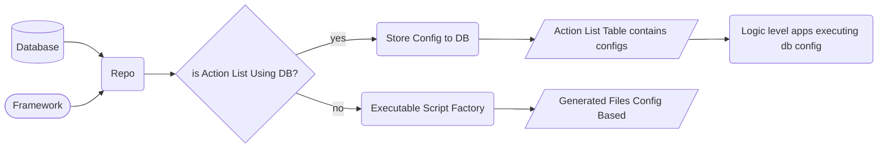

***
Generic API merupakan developers tool untuk memudahkan penambahan service/API. Jika ke depannya diasumsikan akan ada banyak aplikasi yang perlu dibuat dengan minimnya resource, maka ini akan jadi solusi.

Generic API memudahkan dengan cara mengurangi intensitas code developer karena untuk membuat sebuah service basic sesuai kebutuhan (pattern tertentu) tidak memerlukan kemampuan atau intake langsung terhadap code atau bahasa pemrograman yang sudah digunakan. Dengan melakukan konfigurasi menggunakan database yang sudah ada, direlasikan secara otomatis (variable name replacement), serta dengan standar framework atau struktur yang sudah disepakati, maka API sudah dapat disajikan jika masih dalam pola yang syaratnya terpenuhi.

Engine logic dari Generic API sendiri adalah dengan cara sebagai berikut.

1. Siapkan bahan: struktur database dan struktur folder
2. Setelah struktur kasar, selanjutnya adalah konsensi terhadap logic atau bagaimana tipe service/action yang perlu disediakan (misal Create/Update/Delete dsb)
3. Sebuah executable script untuk menyimpan pola action & database uses, dengan database uses dibuat general atau replaceable sesuai kebutuhan. Di dalam executable script ini berisi generator yang dapat membuat file.
4. Optional, jika file tidak bisa dibuat secara autogenerate, maka solusi lainnya adalah memuat sebuah tabel dedicated untuk actions/API yang berisi simpanan config, dan script tambahan ini berfungsi untuk eksekusi row config yang ingin dituju. Secara struktur, ini akan terlihat lebih clean nantinya

